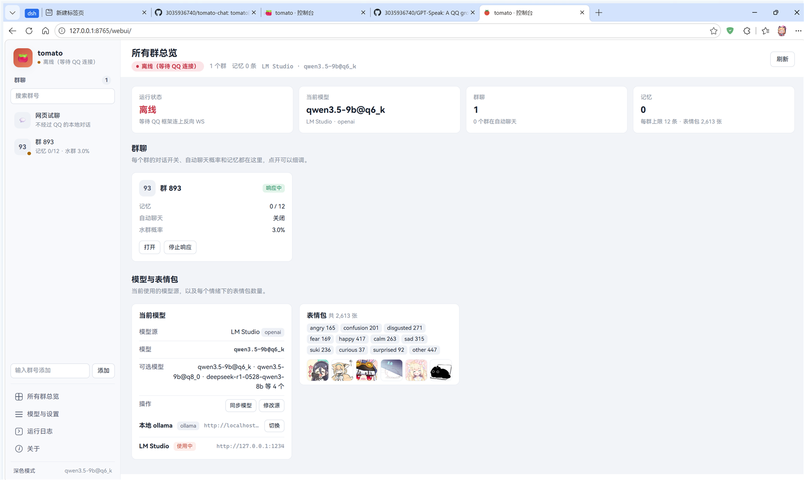

# tomato-chat v2

[](https://github.com/Nekobrush/tomato-chat-v2/actions/workflows/tests.yml)
[](LICENSE)
[](https://www.python.org/)
[](https://nonebot.dev/)

**English** | [简体中文](README.zh-CN.md)

A QQ group chatbot that runs on [NoneBot2](https://nonebot.dev/) + OneBot v11 and talks to a
local LLM (ollama / LM Studio) or any OpenAI-compatible API. It ships with a built-in web
console, editable persona and prompts, group/private memory, emotion stickers, and
multimodal image input.

> This is the v2 rewrite. The original NoneBot1 plugin lives at
> [3035936740/tomato-chat](https://github.com/3035936740/tomato-chat).



## Features

- **Any model source** — ollama, LM Studio, DeepSeek, OneAPI, or anything speaking the
  OpenAI chat-completions API. Sources are declared in `bot_config.MODELS`; context size,
  concurrency and vision support can be set per source.
- **Web console** at `http://127.0.0.1:8765/webui/` — live status, per-group switches,
  model switching, log viewer, test chat (drag & drop images), and a prompt editor.
- **Editable persona** — the whole system prompt, few-shot examples, correction tips,
  fallback copy and scene notes live in `webui_prompts.json` and can be edited in the
  browser. Nothing needs a restart.
- **Message decoration** — optional start marker, prefix, suffix and end marker, assembled as
  `start + prefix + body + suffix + trailing punctuation + end`; the suffix is inserted
  before a trailing punctuation mark, the end marker always goes last.
- **Multi-bubble replies** — split a reply by regex or by character count and send the
  pieces with a human-like delay (`base + per-char × length ± jitter`).
- **Group + private chat** — private messages reuse the persona, memory and stickers but
  skip group-only machinery (allow-list, water probability, queueing, commands).
- **Queueing & focus** — simultaneous @mentions are queued per user, merged while typing,
  and each reply is anchored to the current speaker so topics do not blur together.
- **Multimodal** — when the model supports images (auto-probed, or pinned per source), @
  mentions and replies to the bot are always inspected; other images follow the water
  probability. Images are downscaled/size-capped and sent as data parts.
- **Memory** — per-group (and per-user for private chats) with a token budget, optional
  persistence to `data/memory/`, and `--persistence` records that survive trimming.
- **2620+ emotion stickers** — a reply ends with `--*emotion*--`, and a matching sticker is
  attached with configurable probability.

## Quick start

Requirements: Python 3.10+ and a running model endpoint (ollama at `127.0.0.1:11434`, or
LM Studio at `127.0.0.1:1234` with a model loaded).

```bash
git clone https://github.com/Nekobrush/tomato-chat-v2.git
cd tomato-chat-v2
python -m venv .venv
.venv\Scripts\activate          # Windows
# source .venv/bin/activate     # Linux / macOS
pip install -r requirements.txt
copy .env.example .env          # Windows; cp on Linux/macOS
python main.py
```

On Windows you can also just double-click **`start.bat`**: it creates the venv, installs
dependencies, starts the bot with a visible console, and opens the web console. Closing that
console window stops the bot.

Open <http://127.0.0.1:8765/webui/> for the console.

## Connecting to QQ

The bot speaks OneBot v11 over a reverse WebSocket:

```
ws://127.0.0.1:8765/onebot/v11/ws
```

Point your QQ framework (NapCat, LLOneBot, Lagrange, SnowLuma, …) at that URL, or configure
a forward connection in `.env`:

```ini
ONEBOT_WS_URLS=["ws://127.0.0.1:3001"]
```

Only one direction is needed. Set `ONEBOT_ACCESS_TOKEN` on both sides if your framework uses
a token. Add the target group numbers to `ALLOW_GROUPS` (or via the console) — it is a strict
allow-list and the bot replies to nothing when it is empty.

## Configuration

Two layers:

| File | Purpose |
| --- | --- |
| `.env` | NoneBot runtime: driver, host/port, `SUPERUSERS`, `COMMAND_START`, access token |
| `bot_config.py` | Business defaults: model sources, probabilities, memory, vision, splitting |
| `webui_config.json` | Overrides written by the console; delete it to fall back to `bot_config.py` |
| `webui_prompts.json` | Persona and prompt overrides; delete it to restore the built-in defaults |

Model source example:

```python
MODELS = {
    "local": {"type": "ollama", "label": "本地 ollama",
              "url": "http://localhost:11434", "model": ["llama3.1:latest"]},
    "lmstudio": {"type": "openai", "label": "LM Studio",
                 "url": "http://127.0.0.1:1234", "model": ["qwen3.5-9b@q6_k"],
                 "extra_body": {"reasoning_effort": "none"},
                 "vision": ["qwen3.5-9b"]},   # or True / "*" / "off"
}
DEFAULT_SOURCE = "local"
```

Per-source options: `type` (`ollama`/`openai`), `url`, `api_key`, `extra_body`, `model`,
`vision`, `context`, `concurrency`. The console can edit all of them.

## Commands

| Command | Who | What |
| --- | --- | --- |
| `chat <text>` | everyone | force a reply in this group |
| `chatsys [--persistence] <text>` | superuser | append/update a system rule for this group |
| `chatcls` | group admin | clear the group's memory |
| `chatstart` / `chatstop` | group admin | enable / pause automatic replies |
| `chatset p <0-1>` | everyone (capped 0.125) | set water probability |
| `chatset l` | everyone | list model sources / models |
| `chatset s <source>` / `chatset m <index>` | superuser | switch source / model |
| `chatset ss` | superuser | sync the model list from the source |
| `chatset c` / `chatset r` | group admin | ignore / resume a group |

Commands are prefixed with any of `/ ! ！ y tomato`, e.g. `tomato chat 你好`.

## Deployment

Docker:

```bash
docker build -t tomato-chat .
docker run -d --name tomato-chat -p 8765:8765 \
  -v "$PWD/data:/app/data" -v "$PWD/webui_config.json:/app/webui_config.json" \
  tomato-chat
```

Linux service: copy `deploy/tomato-chat.service` to `/etc/systemd/system/`, adjust
`WorkingDirectory`/`ExecStart`, then `systemctl enable --now tomato-chat`.

Put a reverse proxy in front of it if it must be public, and set `WEBUI_TOKEN` — once the
request no longer comes from localhost, the console requires that token.

## Development

```bash
pip install -r requirements-dev.txt
pytest -q          # 227 tests
ruff check .       # lint
```

Layout: `bot_plugins/ai_chat/` (plugin: pipeline, queue, providers, prompts, vision, memory),
`webui/` (FastAPI console + static files), `tests/`, `tools/` (benchmarks).

## License

[MIT](LICENSE). The sticker images under `resources/emotions/` are not part of the
repository history; bring your own or use the empty directories.
