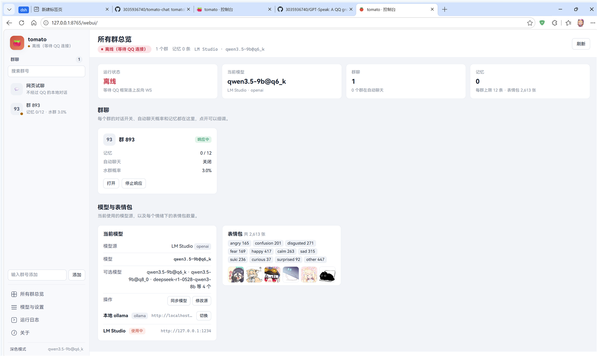
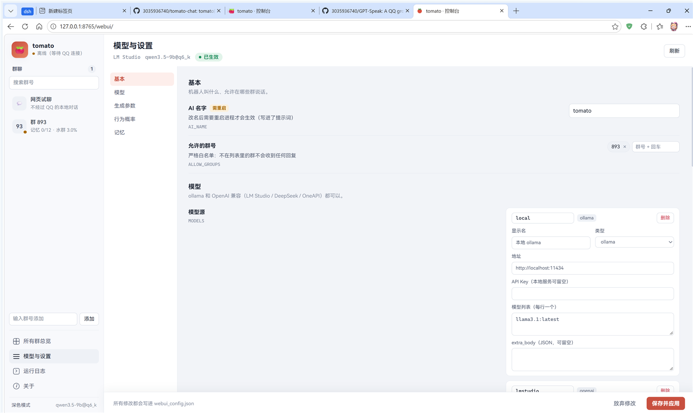

# Tomato AI Chat（NoneBot2 版）

[English](README.md) | **简体中文**

一只会在 QQ 群里水群的猫娘聊天机器人：本地大模型生成回复，按情绪配一张猫娘表情包，带群聊记忆。

项目由早期的 NoneBot1 版本迁移而来（见文末「迁移说明」），运行在 **Python 3.14 + NoneBot2 2.5.0 + OneBot V11** 上。

## 功能

- **人设聊天**：回复末尾用 `--*情绪*--` 标记情绪，机器人据此从对应文件夹抽图；每条消息可以自动套上「起始符 + 前缀 + 正文 + 后缀 + 结束符」（人格设定页配置，默认都不加），后缀会自动插在句末标点前面。
- **群聊记忆**：每个群独立保存最近 12 条对话；连续发消息会自动合并；`chatsys --p` 设定的内容不会被裁掉。
- **主动水群**：`@机器人` 必回；开启自动聊天后按概率随机接话，普通成员可调的概率有上限。
- **私聊**：一对一聊天，单独记忆（每个 QQ 一份）；不加载群聊的白名单、水群概率、排队合并和指令权限，纯粹聊天。
- **看图说话**：切换到带视觉能力的模型（Qwen2.5-VL、LLaVA、GPT-4o 等）后，群友发的图/表情包会被一起送进模型；`@` 或回复机器人时必看，其他人按水群概率决定看不看。纯文本模型下自动退回旧行为。
- **排队与合并**：生成一次要几秒，期间的 @ 不会各排一条——同一个人连发的消息合并成一条待办，不同的人按先后顺序各回一条，谁也不会被无视；生成时还会点名「现在回应谁」，减少串话题和重复作答。
- **模型管理**：支持两类模型源——ollama 原生协议，以及 OpenAI 兼容 API（LM Studio、DeepSeek、OneAPI 等）；可多源、多模型热切换，可从当前源同步模型列表。
- **群级开关**：按群开启/关闭对话与自动聊天，支持群白名单。
- **权限分级**：超级管理员（`.env` 的 `SUPERUSERS`）、群主/群管理员、普通成员三级权限。
- **网页控制台**：内置 WebUI，在浏览器里看状态、改配置、调群开关、查记忆、试聊、看日志，改动即时生效。
- **一键启动**：双击 `start.bat`（或 `python launcher.py`）自动准备虚拟环境、装依赖、启动机器人并打开网页。

## 环境要求

| 依赖 | 说明 |
| --- | --- |
| Python | ≥ 3.10，本项目在 3.14.7 上开发与测试 |
| NoneBot2 | 2.5.0（`nonebot2[fastapi]`） |
| OneBot 适配器 | nonebot-adapter-onebot 2.4.6（OneBot V11） |
| ollama | 可选：本地模型服务，默认 `http://localhost:11434`；也可以用 OpenAI 兼容服务代替 |
| LM Studio / 云端 API | 可选：任何 OpenAI 兼容接口（LM Studio、DeepSeek、OneAPI 网关等） |
| QQ 机器人框架 | 支持 OneBot V11 反向 WebSocket 的实现（NapCat、LLOneBot、Lagrange.OneBot 等） |

## 安装

```bash
python -m venv .venv
# Windows
.venv\Scripts\activate
# Linux / macOS
source .venv/bin/activate

pip install -r requirements.txt
# 需要跑测试时再装
pip install -r requirements-dev.txt
```

不想手动敲命令的话，直接用下面的「一键启动」，它会自动完成上面这些步骤。

## 一键启动

**Windows**：双击项目根目录的 `start.bat`。

**任何系统**：

```bash
python launcher.py                 # 准备虚拟环境 → 装依赖 → 启动 → 自动打开 WebUI
python launcher.py --no-browser    # 不自动打开浏览器
python launcher.py --reinstall     # 强制重装依赖
python launcher.py --port 9000     # 临时换端口
```

启动器会：

1. 没有 `.venv` 就用当前 Python 创建一个；
2. 按 `requirements.txt` 的内容哈希判断要不要 `pip install`（改过依赖才会重装）；
3. 启动 `main.py`，轮询 `/api/health` 等待就绪；
4. 自动打开 `http://127.0.0.1:8765/webui/`；
5. 按 `Ctrl+C` 时一并停掉机器人进程。

如果端口上已经有服务在跑，它会直接打开网页，不会再起一个进程。

## 配置

配置分两处，互不冲突：

- **`.env`**：NoneBot 自身配置（复制 `.env.example` 后修改）。
- **`bot_config.py`**：机器人业务配置，直接改 Python 常量即可。

### `.env`

| 键 | 说明 |
| --- | --- |
| `DRIVER` | 默认 `~fastapi`，提供反向 WebSocket 服务 |
| `HOST` / `PORT` | 监听地址，默认 `0.0.0.0:8765` |
| `LOG_LEVEL` | 日志级别 |
| `SUPERUSERS` | 超级管理员 QQ 列表（旧版 `super_admin_users` + `admin_users` 合并） |
| `COMMAND_START` | 指令前缀，必须与 `bot_config.COMMAND_PREFIXES` 一致 |
| `ONEBOT_ACCESS_TOKEN` / `ONEBOT_SECRET` | 反向 WS 校验用，留空表示不校验 |

### `bot_config.py` 常用项

| 常量 | 说明 |
| --- | --- |
| `AI_NAME` | 机器人自称的出厂默认值；改名字在网页「人格与提示词」里改，会写进 `webui_prompts.json` |
| `ALLOW_GROUPS` | 允许工作的群号集合，**必须把群号写进来**；留空则机器人不理会任何群 |
| `MODELS` | 模型源表，每项支持 `type`（`ollama` / `openai`）、`label`、`url`、`api_key`、`model`、`extra_body`、`context`、`concurrency`、`vision` |
| `DEFAULT_SOURCE` / `DEFAULT_MODEL_INDEX` | 默认模型源与默认模型下标 |
| `GLOBAL_CTX` / `PREDICT` / `TEMPERATURE` / `TOP_K` / `TOP_P` / `REPEAT_PENALTY` | 生成参数；`GLOBAL_CTX`/`TOP_K`/`REPEAT_PENALTY` 只对 ollama 直接生效，OpenAI 兼容源需在模型源里开启 `send_sampling` 或写进 `extra_body`；`GLOBAL_CTX` 是默认值，单个源可用 `context` 覆盖 |
| `STOP_SEQUENCES` | 解码停止串，默认 `("\n",)`：提示词要求单行、结尾一个情绪标记，遇到换行就停能少生成不少 token |
| `LOG_USAGE` | 每次调用后打印 `prompt/completion/耗时/tok/s`，方便本地对比优化效果 |
| `MAX_MEMORY` | 每群记忆条数上限 |
| `MEMORY_TOKEN_BUDGET` | 每群记忆的 token 预算，`0` = 按 `GLOBAL_CTX` 的 35% 自动估算；长句群会自动少留几条 |
| `MEMORY_PERSIST_ENABLED` | 记忆持久化：开启后每个会话一份 JSON（`data/memory/`），重启不再失忆；默认关闭 |
| `WEBUI_SESSION_GROUP` / `WEBUI_SESSION_BOT_ID` | 网页试聊用的虚拟会话键与「机器人 QQ 号」 |
| `PENDING_DEBOUNCE` | 收到 @ 后先等多久（秒），把同一波连发合并成一条待办，默认 0.4；按「一个人连打两句话的间隔」定 |
| `PENDING_TTL` | 待办超过多少秒还没轮到就丢弃，避免回一句过时的话，默认 20；按「4–6 倍单条生成耗时」定 |
| `PENDING_TEXT_LIMIT` | 同一个人的多条消息合并后最多保留多少字符，默认 200 |
| `PRIVATE_CHAT_ENABLED` | 是否回应私聊，默认 `True` |
| `ALLOW_PRIVATE_USERS` | 允许私聊的 QQ 号集合；**留空表示所有私聊用户**，填了就只回这些人 |
| `DEFAULT_WATER_PROBABILITY` | 自动聊天时被概率（0.03 表示约 3% 的消息会接话） |
| `SEND_IMAGE_PROBABILITY` | 回复附带表情包的概率 |
| `REPLY_PROBABILITY` | 回复时使用 QQ「引用回复」的概率 |
| `VISION_ENABLED` | 是否让视觉模型看图（`@` / 回复必看，其他人按水群概率），默认开启 |
| `VISION_MAX_IMAGES` | 一条消息最多送几张图，默认 3 |
| `VISION_MAX_BYTES` | 单张图大小上限，默认 4 MB |
| `EMOTION_PIC_PATH` | 表情包根目录 |
| `EMOTIONS` | 情绪名列表，同时决定表情包文件夹名 |

### 模型源（ollama / OpenAI 兼容）

`bot_config.MODELS` 是一个字典，键是源名称，值描述连接方式：

```python
MODELS = {
    # ollama 原生协议
    "local": {
        "type": "ollama",
        "label": "本地 ollama",
        "url": "http://localhost:11434",
        "model": ["llama3.1:latest"],
    },
    # OpenAI 兼容：LM Studio
    "lmstudio": {
        "type": "openai",
        "label": "LM Studio",
        "url": "http://127.0.0.1:1234",  # 结尾的 /v1 可省略
        "api_key": "",
        "model": ["qwen3.5-9b@q6_k"],
        "extra_body": {"reasoning_effort": "none"},
    },
    # OpenAI 兼容：云端 API
    "deepseek": {
        "type": "openai",
        "label": "DeepSeek",
        "url": "https://api.deepseek.com",
        "api_key": "sk-...",
        "model": ["deepseek-chat"],
    },
}
```

- `type` 省略时按 `ollama` 处理，兼容旧配置；也接受 `openai-compatible`、`lmstudio` 等别名。
- OpenAI 兼容源会自动补齐地址结尾的 `/v1`。
- `api_key` 非空时自动带上 `Authorization: Bearer <api_key>`。
- `extra_body` 里的字段会原样合并进请求体，用来传各家的专有参数。
- `context` 可选：这个源自己的上下文长度。本地小模型写 `8192`、云端大模型写 `131072`，互不影响；不写就用全局 `GLOBAL_CTX`。
- `concurrency` 可选：这个源允许同时进行的生成数，默认 `1`。本地单卡保持 1（显存和速度都更稳），云端 API 可以调大。
- `vision` 可选：`true` / `false` / `["qwen3.5-9b"]` / `"*"`，见下面的「多模态」。
- 推理模型（DeepSeek-R1、Qwen3 思考模式）默认「先思考再回答」，128 token 会被思考内容吃光。LM Studio 可加 `"extra_body": {"reasoning_effort": "none"}` 关闭思考，或调大 `PREDICT`。
- 切换源：`chatset s <源>`；同步模型列表：`chatset ss [源]`（ollama 调 `/api/tags`，OpenAI 兼容调 `/v1/models`）。

### 准备表情包

> **表情包不在 git 里。** `resources/emotions/` 有 372 MB 图片，被 `.gitignore` 排除，所以
> `git clone` 下来只有代码。想要开箱即用（代码 + 全部 2613 张表情包），到
> [Releases](https://github.com/Nekobrush/tomato-chat-v2/releases) 下载
> `tomato-chat-v2.0.0.zip` 解压即可，不用再 clone。没有表情包时机器人照常工作，只是只发文字。

按情绪分文件夹放图片即可，支持 `.png/.jpg/.jpeg/.gif/.webp`：

```
resources/emotions/
├── happy/
├── sad/
├── angry/
├── calm/
├── suki/
├── surprised/
├── confusion/
├── fear/
├── disgusted/
├── curious/
└── other/
```

单张图片默认上限 8 MB（`IMAGE_MAX_BYTES`），超出会被跳过。

## 启动

先让默认模型源可用。二选一：

```bash
# 方式 A：ollama（把 bot_config.DEFAULT_SOURCE 改成 "local"）
ollama serve
ollama pull llama3.1:latest

# 方式 B：LM Studio（默认配置用的就是它）
lms server start      # 或在 LM Studio 界面里开启 Local Server
```

再启动机器人：

```bash
python main.py
```

正常时日志会显示插件加载成功、适配器就绪，并监听 `http://0.0.0.0:8765`。
反向 WebSocket 地址为：

```
ws://127.0.0.1:8765/onebot/v11/ws
```

> 用 HTTP 直接访问该地址会返回 404，这是正常的——它是 WebSocket 专用路由。

## 网页控制台（WebUI）

WebUI 内嵌在机器人自己的 FastAPI 应用里，和 OneBot 反向 WS 共用 `8765` 端口，**不需要额外启动一个服务**。启动后打开：

```
http://127.0.0.1:8765/webui/
```





左侧是白名单群列表（顶部带连接状态点、可按群号搜索、可直接加群），点进去看单个群的详情；左下角是四个全局视图，底部可切换浅色/深色主题。

| 位置 | 能做什么 |
| --- | --- |
| 所有群总览 | 在线状态、当前模型源/模型、群数、记忆总数、表情包数量；切换模型源/模型、同步模型列表 |
| 单个群 › 概览 | 开关本群对话与自动聊天、拖动水群概率滑杆、清空记忆、移出白名单、看情绪分布与表情包 |
| 单个群 › 记忆 | 查看该群的记忆条目与角色，支持刷新与清空 |
| 单个群 › 试聊 | 不经过 QQ、单独和猫娘对话，用 `webui-test` 独立记忆，不影响群聊 |
| 模型与设置 | 编辑模型源（地址、API Key、模型列表、`extra_body`）、默认模型、生成参数、行为概率、记忆条数、群号白名单、分条发送（正则 / 字符数 / 间隔） |
| 人格与提示词 | 分层编辑人设（① 常驻前缀 ② 说话方式 ③ 人格设定）、few-shot 示例、消息起始符/前缀/后缀/结束符、两条纠正提示、调用失败兜底、私聊说明、群聊聚焦指令、时间身份说明、空回复兜底；导入/编辑酒馆世界书与角色书；从角色卡（PNG / JSON）拆出人格层、示例与角色书；调试预览一眼看清本轮实际发给模型的消息 |
| 运行日志 | 查看 `logs/bot.log` 最近 400 行，WARNING/ERROR 高亮，新行只追加不重绘，可勾选自动刷新 |
| 关于 | 版本、启动时间、配置与日志位置说明 |

### 分条发送

一条回复可以切成多条消息气泡分开发，让长回复更像真人打字。设置首项在「模型与设置 › 基本」里，三项都可留空 / 置 0：

| 设置 | 作用 |
| --- | --- |
| `SPLIT_PATTERN` | 正则切分，例如 `[。！？]`；切分会吃掉匹配到的字符，想保留标点就用 `([。！？])` |
| `SPLIT_MAX_CHARS` | 每条的字符上限，超了就在句末标点处硬切；`0` 表示不按字数切 |
| `SPLIT_DELAY_BASE` | 两条气泡之间的基准停顿（秒） |
| `SPLIT_DELAY_PER_CHAR` | 按上一条的字数线性追加的停顿（秒/字） |
| `SPLIT_DELAY_JITTER` | 在算出的停顿上随机加减的范围（秒），避免节奏过于机械 |

两个切分条件都留空 / 为 0 时就是整条发出。停顿按「基准 + 字数 × 每秒字数 + 随机浮动」计算，且不会小于 0。切分只发生在发送阶段，记忆里仍然只存一条完整回复；引用回复和表情包挂在第一条气泡上。

### 多模态（看图）

机器人能不能看图，取决于**当前模型**有没有视觉能力。判断分三层，优先级从高到低：

1. 模型源里的 `vision` 配置（想强行指定时用）；
2. 向服务端探测：LM Studio 查 `/api/v0/models` 的 `type=vlm`，ollama 查 `/api/show` 的 `capabilities`（探测一次后缓存，失败最多等 3 秒）；
3. 都拿不到时按模型名匹配（`VISION_MODEL_PATTERNS`：`vl`、`vision`、`llava`、`qwen2.5-vl`、`gpt-4o`、`claude`、`gemini` 等）。

所以 LM Studio 里 `type=vlm` 的模型不用手写配置就能被识别；名字对不上或者想强行指定时，在模型源里写 `vision`（网页「模型与设置 › 模型源」里有「能看图的模型」输入框）：

```python
"lmstudio": {
    "type": "openai",
    "url": "http://127.0.0.1:1234",
    "model": ["qwen3.5-9b@q6_k"],
    # 只标记某些模型（大小写不敏感，写片段即可覆盖同名不同量化版本）
    "vision": ["qwen3.5-9b"],
    # 或者：整个源都算多模态
    # "vision": True,
    # 或者：明确关掉
    # "vision": False,
}
```

网页里那一栏的写法：一行一个模型名（片段即可），留空＝按名字自动判断，填 `*`＝这个源所有模型都支持，填 `off`＝明确关闭。保存后立即生效，当前模型是否支持看图会显示在「所有群总览 › 当前模型 › 看图」一行。

| 设置 | 作用 |
| --- | --- |
| `VISION_ENABLED` | 总开关，关掉就完全不下载、不送图 |
| `VISION_MAX_IMAGES` | 一条消息最多看几张图，默认 3 |
| `VISION_MAX_BYTES` | 单张图上限，超过就跳过，默认 4 MB |

触发规则：

- `@机器人` 或**回复机器人**的消息：有图必看；
- 其他人发的图：只在轮到它「水群接话」时才看，没被概率选中就只记一条占位 `[图片]`，不下载图片；
- 纯图片消息在没有视觉模型时和以前一样直接忽略。

图片会在锁内、确定要生成时才下载并转 base64，只挂在最后一条 user 消息上（不会把历史里的图重复塞进 prompt）。ollama 走 `images` 字段，OpenAI 兼容源走 `image_url` + `data:` URL。

> 当前默认模型 `qwen3.5-9b@q6_k` 在 LM Studio 里是 `type=vlm`，会被自动识别为多模态；如果换的模型是纯文本的，这项功能自动退回「忽略图片」，不需要改代码。


### 人格、设定书与角色卡

「人格与提示词」页把人设拆成三层，越靠前越稳定、越容易命中模型服务端的 prompt 缓存：

1. **常驻前缀**：身份声明、安全边界、消息格式与情绪标记格式，一般不用改；
2. **说话方式**：语气、长度、要不要用 emoji、什么时候该简短；
3. **人格设定**：名字、来历、创造者、身份定位，从酒馆角色卡导入时会落到这一层。

后面接 few-shot 示例，再是流式记忆，最后是每轮临时拼到**最后一条 user 消息尾部**的东西：当前时间、纠正提示、设定书命中的条目、聚焦对象。之所以不插到前面，是因为 LM Studio 的 Qwen 模板不接受中途出现的 system 消息，而且放尾部不会破坏前缀缓存。

**设定书**（酒馆 World Info v2 / 角色书）存在 `webui_books.json`，可以粘贴导入、逐条编辑、导出回酒馆格式。命中规则与酒馆一致：`constant` 常驻必中，否则主关键词命中后再按 `selectiveLogic`（AND ANY / NOT ALL / NOT ANY / AND ALL）判副关键词，可选按 `probability` 掷骰，最后按 `order` 排序并受字数预算约束。酒馆的 `position` / `depth`（插在角色定义前后、按深度插入）**无法照搬**——导入时会保留原值，但实际注入位置固定在尾部。

**角色卡**支持 PNG（读 `tEXt`/`iTXt` 里的 `chara`/`ccv3` 块）和 JSON 两种。导入前会先给一份预览（名字、人格层字数、角色书条数），确认后才写入：`description` + `personality` + `system_prompt` 拼成人格层，`mes_example`（或 `first_mes`）拆成示例，`character_book` 转成角色书。

**调试预览**输入一句话，就把这一轮真正要发给模型的消息全部列出来（角色徽章、字数、图片数、总 token 估算），用来确认设定书有没有命中、尾部拼了什么。


- **状态页（总览、单群概览）每 8 秒增量刷新**：只替换内容真的变了的区块（状态卡、群卡片、模型卡、表情包），不重建整页，所以选中的文字、滚动位置、正在看的卡片都不会被打断。
- **运行日志每 4 秒追加**：只把新行插到末尾，滚到底部时自动跟随，勾掉「自动刷新」就完全停止。
- **设置页与人格页不自动刷新**：避免覆盖正在编辑的表单，改完点「保存并应用」；想丢弃改动重新读取服务端值，点右上角「刷新」。
- 标签页切到后台时所有轮询都会暂停，切回来继续。

### 配置存在哪里

网页上保存的设置写到项目根目录的 **`webui_config.json`**，`bot_config.py` 在导入时会读它并覆盖同名默认值，所以重启后依然生效，也不用改 Python 源码。

- 删掉 `webui_config.json` 就回到 `bot_config.py` 里的默认值；
- 群开关、水群概率这类运行期状态只存在内存里，重启后回到默认；
- 人格与提示词（含 **AI 名字**）单独存在 **`webui_prompts.json`**，删掉就回到代码里的默认文案和 `bot_config.AI_NAME`；保存时会在进程内重新构建提示词，下一条回复即生效，不用重启；
- 设定书存在 **`webui_books.json`**，删掉就回到没有设定书的状态；
- 记忆默认只存内存；把「记忆持久化」打开后每个会话写一份 `data/memory/<群号或会话>-<hash>.json`，重启后自动读回。

提示词文案里支持占位符，运行时替换：人设里的 `{ai_name}`（AI 名字）、`{emotions}`（11 个情绪清单），太长提示里的 `{limit}`（`RESP_LEN_LIMIT`），聚焦指令里的 `{who}` / `{target}` / `{quoted}`，时间说明里的 `{timestamp}` / `{time}` / `{self_id}`。花括号写错不会崩溃，会被原样保留。

### 远程访问

默认只允许本机（`127.0.0.1` / `localhost`）访问。想从别的机器打开，先设置环境变量再启动：

```powershell
$env:WEBUI_TOKEN = "换成一个长一点的随机串"
python main.py
```

然后访问时带上令牌：网页首次请求会弹窗要你输入（保存在浏览器 localStorage），或者直接 `http://<ip>:8765/webui/?token=...`。

## 接入 QQ

在机器人框架里新增一个**反向 WebSocket** 连接，地址填上面的 `ws://…/onebot/v11/ws`；若 `.env` 里设置了 `ONEBOT_ACCESS_TOKEN`，在框架侧填同一个 token。连接成功后，把机器人拉进群，发 `tomato chat 你好` 或 `@机器人 你好` 即可。

## 指令

前缀可用 `/`、`!`、`！`、`y`、`tomato`，例如 `/chat`、`y chat`、`tomato chat` 都行。

| 指令 | 权限 | 说明 |
| --- | --- | --- |
| `chat <内容>` | 所有人 | 让机器人回复一句 |
| `chatsys <内容>` | 超级管理员 | 追加群设定，`--p` 表示持久化（不参与裁剪） |
| `chatcls` | 群主/群管理员 | 清空本群记忆 |
| `chatstart` | 群主/群管理员 | 开启本群自动聊天（水群） |
| `chatstop` | 群主/群管理员 | 关闭本群自动聊天 |
| `chatset p <概率>` | 所有人（普通成员上限 0.125） | 设置本群水群概率，如 `chatset p 5%` |
| `chatset l` | 所有人 | 查看当前模型源与模型 |
| `chatset s <源>` | 超级管理员 | 切换模型源（`bot_config.MODELS` 里的键名） |
| `chatset m <序号>` | 超级管理员 | 切换模型 |
| `chatset ss [源]` | 超级管理员 | 从模型源同步模型列表 |
| `chatset c` / `chatset r` | 群主/群管理员 | 关闭 / 重新开启本群对话 |

`chatset ss` 会把模型源里可用的模型列表写回 `bot_config.MODELS`（仅本次运行有效），首次使用建议先同步一次。

## 目录结构

```
tomato-chat/
├── main.py                     # 入口：初始化 NoneBot、注册适配器、加载插件、挂载 WebUI
├── launcher.py                 # 一键启动：准备环境 → 启动 → 打开网页
├── start.bat                   # Windows 双击启动
├── bot_config.py               # 业务配置
├── webui_config.json           # 网页保存的覆盖配置（删除即回默认，自动生成）
├── .env / .env.example         # NoneBot 原生配置
├── requirements.txt
├── bot_plugins/
│   └── ai_chat/
│       ├── __init__.py         # matcher 接线、普通消息处理
│       ├── commands.py         # 指令分发与各指令实现
│       ├── runtime.py          # 群状态与权限判断
│       ├── messaging.py        # 发送辅助（记录 → 生成 → 发送）
│       ├── prompts.py          # 人设与纠错提示
│       ├── text.py             # CQ 码 / emoji / 情绪解析、指令解析
│       ├── memory.py           # 群记忆存储
│       ├── errors.py           # LLMError
│       ├── model.py            # 模型源管理、统一调用入口
│       ├── providers/          # 模型后端
│       │   ├── base.py         #   抽象基类与生成参数
│       │   ├── ollama.py       #   ollama 原生协议
│       │   └── openai.py       #   OpenAI 兼容协议
│       └── pipeline.py         # 生成流程：记忆 → 模型 → 表情包 → 消息
├── webui/                      # 网页控制台（挂在 NoneBot 的 FastAPI 上）
│   ├── __init__.py             # setup(app)：路由、静态页面、日志文件
│   ├── api.py                  # /api/* 接口
│   ├── config_store.py         # 配置校验、保存与 webui_config.json
│   └── static/                 # index.html / style.css / app.js
├── logs/bot.log                # 运行时日志（自动生成）
├── resources/emotions/         # 表情包
└── tests/                      # pytest 测试
```

## 测试

```bash
pip install -r requirements-dev.txt
pytest -q
ruff check .
```

当前 258 个用例全部通过，覆盖指令解析、记忆裁剪/合并与 token 预算、模型切换与同步、两种模型后端的请求/错误处理、生成流程、提示词前缀稳定性与分层、回复排队与合并、私聊（配置开关与白名单）、多模态图片链路与触发规则、酒馆世界书导入导出与尾部注入、角色卡（JSON / PNG）拆层、WebUI 的配置校验与接口，以及插件冒烟。

项目元数据、依赖与 `pytest` / `ruff` 配置都在 `pyproject.toml`；版本号只在 [`bot_plugins/ai_chat/_version.py`](bot_plugins/ai_chat/_version.py) 里写一次，WebUI 的 `/api/health` 也读它。

也可以把项目装进当前环境（获得 `tomato-chat` 命令）：

```bash
pip install -e .[dev]
tomato-chat --no-browser
```


### 本地性能测量

`tools/bench_prompt.py` 会对比「旧提示词组装」与「稳定前缀」两种方案的 prompt 长度和连续两轮的 prefill 耗时：

```bash
.\.venv\Scripts\python.exe tools\bench_prompt.py
```

在本机 `qwen3.5-9b@q6_k`（LM Studio）上的实测：

| 指标 | 结果 |
| --- | --- |
| prompt 长度 | 旧 819 tok / 新 796 tok（差别不大，省的是缓存不是字数） |
| 连续两轮 prefill | 旧 0.38s → 0.38s（时间戳一变就全量重算）；新 0.36s → 0.16s（命中前缀缓存） |
| 生成速度 | 约 18–24 tok/s，所以**真正的大头是 decode**：70 token 的回复 ≈ 3s |

结论：前缀缓存每轮省 0.2s 左右；想明显变快得靠「少生成」（`STOP_SEQUENCES`、`PREDICT`）和「别为格式问题重试」。

## 迁移说明（NoneBot1 → NoneBot2）

- 依赖升级到 `nonebot2 2.5.0` + `nonebot-adapter-onebot 2.4.6`，运行在 Python 3.14。
- 单个 1090 行的插件拆成 `prompts` / `text` / `memory` / `model` / `pipeline` / `__init__` 六个模块，事件处理与生成逻辑分离。
- 指令分发改为自己解析前缀：`on_command` 只认「前缀+指令名」紧挨着的写法，会丢掉旧版的 `tomato chat` 这种带空格的用法。
- 修复了旧版的问题：
  - `sync_source` 里引用未定义的 `key` 导致 `NameError`；
  - 记忆时间戳单位不一致（提示词说毫秒、实际写秒）；
  - 遍历 `range` 时 `pop` 造成漏删 / 索引错位；
  - 新记录写入后立刻被裁掉；
  - `SESSION_EXPIRE_TIMEOUT` 重复定义；
  - 清空记忆、开关自动聊天等指令没有权限校验；
  - 缺少每群并发锁，多人同时触发会打乱记忆顺序。
- 行为变化：`chatset p` 现在表示「接话概率」本身（旧版内部存的是 `1-p`，容易配反）；管理员统一用 `SUPERUSERS` 配置；不再通过 `NICKNAME` 触发，避免把 `tomato` 指令前缀吃掉。

## 重构说明（兼容 OpenAI API）

- **模型层解耦**：`model.LLMService` 不再直接持有 ollama 客户端，而是通过 `providers/` 按 `type` 创建后端（`ollama` / `openai`），统一 `GenerationParams` 映射生成参数；provider 懒创建，NoneBot 退出时统一关闭连接。
- **新增 OpenAI 兼容后端**：自动补齐 `/v1`、支持 `api_key`（Bearer）、`extra_body` 透传；HTTP 错误会带上状态码与响应摘要，推理模型把 token 花在思考上时会给出可操作的提示。
- **插件拆分**：`__init__.py` 只负责 matcher 接线与普通消息处理；指令分发、群状态/权限、发送流程分别落到 `commands.py`、`runtime.py`、`messaging.py`。
- **提示词兼容性**：请求只保留一条开头的 `system` 消息，`chatsys` 追加的设定会合并进去；LM Studio 的 Qwen 模板会直接拒绝出现在对话中间的 `system`。
- **本地推理优化**：第 0 条 `system` 只放人设与 `chatsys --p` 的持久化设定，时间戳与纠错提示挪到最后一条 user 消息尾部，让 llama.cpp 的 prefix cache 能命中；旧消息剥掉时间戳前缀压缩 prompt；用户消息在取锁之前就按事件时间记录，排队不会把时间线压平；缺「喵」就地补一个，不再为格式问题重新生成一次。
- **向后兼容**：旧写法 `MODELS = {源名: {"url": ..., "model": [...]}}` 不带 `type` 时仍按 ollama 处理。
- **测试**：从 75 个增加到 110 个，新增 `tests/test_providers.py`（用 `httpx.MockTransport` 验证请求体/鉴权头/错误映射，用假客户端验证 ollama 参数映射）。
- 已在 LM Studio（`qwen3.5-9b@q6_k`）上做过真实联调：`chatset ss` 能同步模型列表，`chat` 能正常拿到回复。
